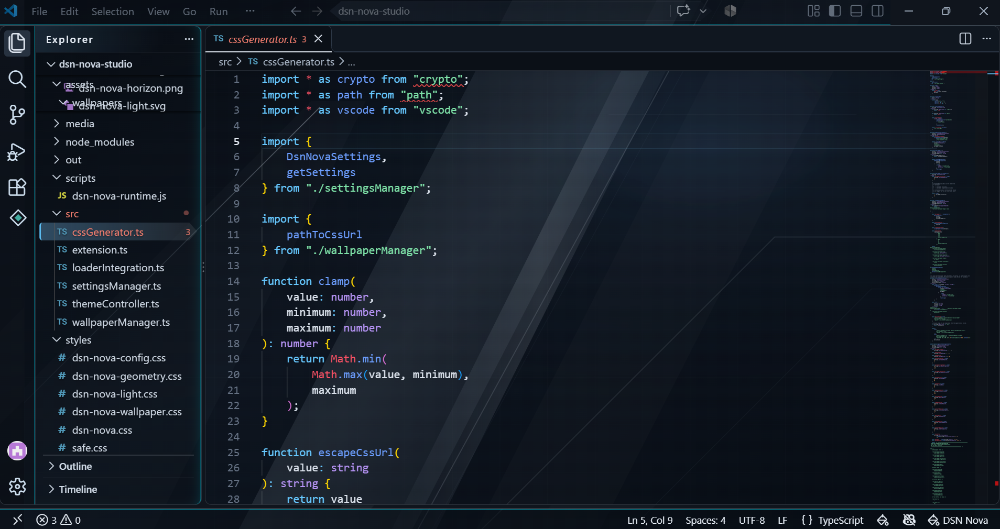
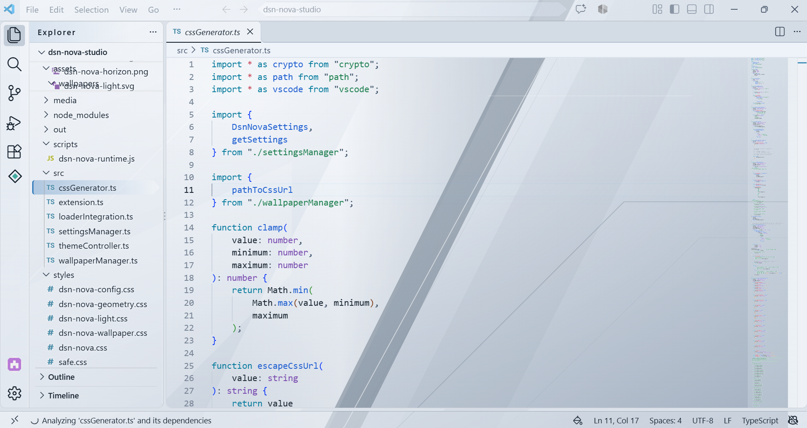
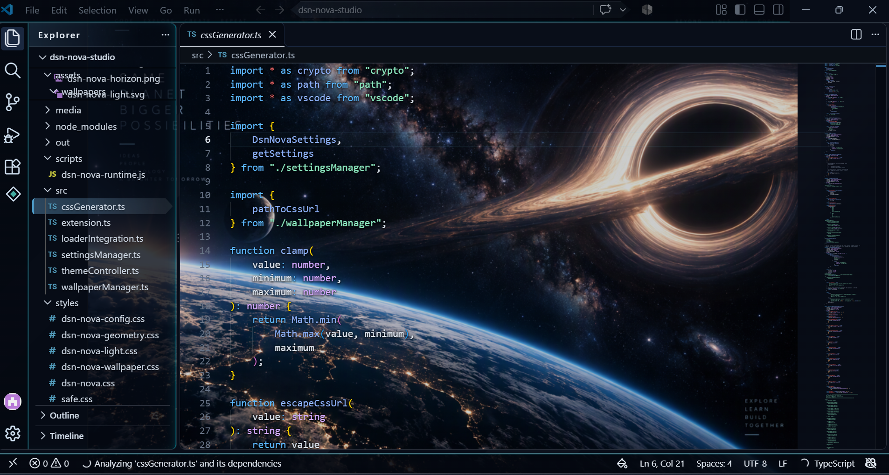
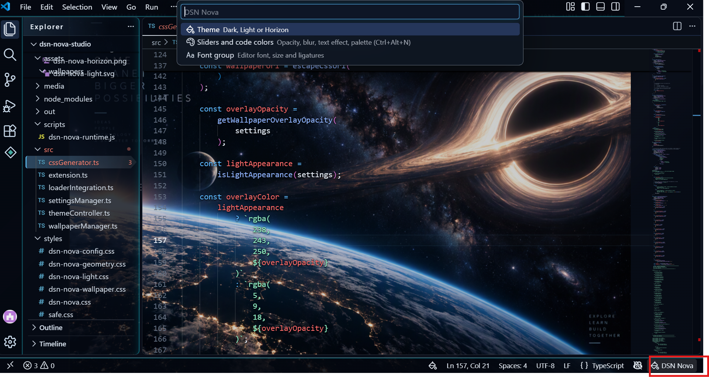
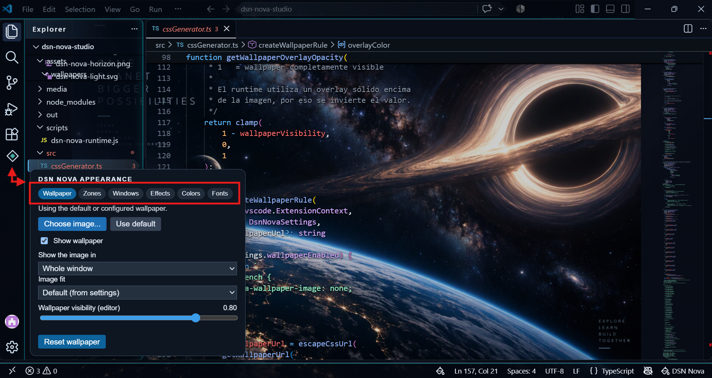

# DSN Nova Experience

A new customization experience for VS Code that makes your hours of development better: **Dark**, **Light** and **Horizon** themes, wallpapers, glass transparency, neon accents and an in-editor panel to change colors, fonts and zones without editing settings.

> Programming first. Every color has a purpose.

## What is this?

DSN Nova Experience is **more than a set of themes**. It also lets you customize how VS Code looks, live, from a panel inside the editor: put a wallpaper behind your code, make the interface translucent like glass, add neon accents, and recolor your code, all with sliders and color pickers. You never need to edit `settings.json`.

> **For the full experience you also need the _Custom CSS and JS Loader_ extension** (`be5invis.vscode-custom-css`). VS Code has no built-in way to change its own interface, and this extension does it for us. DSN Nova Experience sets it up for you, in a few clicks (see [Getting started](#getting-started)).
>
> Without the loader you still get the three color themes. Wallpaper, transparency, neon and the panel need it.

## Themes

### DSN Nova Dark

### DSN Nova Light

### DSN Nova Horizon
A space theme with its own wallpaper and a palette taken from the image.

---

## Highlights

- **Three themes**: DSN Nova Dark, DSN Nova Light and DSN Nova Horizon (a space theme with its own wallpaper).
- **Live panel**: change everything from sliders, pickers and menus. No numbers to type.
- **Wallpaper**: a default image per theme, or your own image with fill, fit, stretch, center and tile modes, for the whole window or only the editor area.
- **Glass transparency**: independent opacity for the sidebar, activity bar, panel, status bar, pages (Settings, Extensions), popups and menus.
- **Readable code over any image**: a soft glow behind the text in dark themes and a soft shadow in Light, adjustable or switchable off.
- **Neon accents**: glowing borders and scrollbar with an adjustable color and intensity.
- **Functional code colors**: seven roles you can recolor.
- **Font groups** and interface font selection.

---

## Requirements

| What you want | What you need |
| --- | --- |
| Only the color themes | Just this extension |
| Wallpaper, glass transparency, neon and the live panel | This extension **and** the [Custom CSS and JS Loader](https://marketplace.visualstudio.com/items?itemName=be5invis.vscode-custom-css) (`be5invis.vscode-custom-css`) |

The loader is listed as a companion extension, so VS Code offers to install it with this one. If it is missing, install it from the Extensions view. DSN Nova Experience injects its CSS and JavaScript through it.

---

## Getting started

1. Install this extension and the **Custom CSS and JS Loader** if VS Code did not already install it.
2. Open the Command Palette (`Ctrl+Shift+P`) and run **Preferences: Color Theme**, then choose one of the DSN Nova themes.
3. Run **DSN Nova: Enable Full Experience**.
4. Accept the loader prompt and restart VS Code when asked.

After a VS Code update the loader may be disabled. Run **DSN Nova: Enable Full Experience** again and restart.

You can also switch themes from the **DSN Nova** item in the status bar, choosing **Theme**. The selector opens at the top of the window:

---

## The DSN Nova panel

Open it with the **diamond button** in the activity bar, or press `Ctrl+Alt+N`. It closes when you click outside it or press `Esc`. Each tab has its own reset button.

| Tab | What you can change |
| --- | --- |
| **Wallpaper** | Choose your own image or return to the default, show or hide the wallpaper, image fit, where it is shown (whole window or editor only) and how visible it is. |
| **Zones** | Opacity of the sidebar, activity bar, panel and status bar, with ready-made presets. |
| **Windows** | Opacity of pages (Settings, Extensions...), popups (Command Palette, dialogs) and popup blur. |
| **Effects** | Text effect for legibility, menu blur and opacity, neon borders, neon scrollbar and neon color. |
| **Colors** | The seven code colors. |
| **Fonts** | Interface font. |

For editor font groups (family, size and ligatures) click **DSN Nova** in the status bar and choose **Font group**.

Panel changes are stored in the VS Code window and take priority over the extension settings until you reset them.

---

## Functional color hierarchy

Each color has a specific function:

| Color | Purpose |
| --- | --- |
| Cyan | Structure, focus and navigation |
| Blue | Functions and methods |
| Purple | Classes, types and properties |
| Green | Strings and successful states |
| Orange | Numbers, decorators and active details |
| Red | Constants, errors and critical actions |
| Gold | Warnings and modified resources |

You can change any of these colors from the **Colors** tab. This changes how the code is colored, not the Dark or Light base of the theme.

---

## Commands

| Command | Description |
| --- | --- |
| DSN Nova: Enable Full Experience | Registers the CSS and JS with the loader. |
| DSN Nova: Open Appearance Panel | Menu with Theme, panel and Font group. |
| DSN Nova: Choose Font Group | Applies a group of editor fonts. |
| DSN Nova: Select Custom Wallpaper | Choose your own wallpaper image. |
| DSN Nova: Use Default Wallpaper | Return to the theme's wallpaper. |
| DSN Nova: Toggle Light/Dark | Switch between DSN Nova Dark and Light. |
| DSN Nova: Apply Appearance | Reapply the configured appearance. |
| DSN Nova: Restore Default Appearance | Return the appearance to its defaults. |
| DSN Nova: Restore Safe Mode | Remove the injected styles. |
| DSN Nova: Show Diagnostics | Show the state of the integration. |

---

## Settings

Most users never need these, because the panel covers them. They are the starting values.

| Setting | Description |
| --- | --- |
| `dsnNova.appearance` | `auto`, `dark` or `light`. |
| `dsnNova.wallpaper.enabled` | Enables the wallpaper. |
| `dsnNova.wallpaper.path` | Path to your own image. |
| `dsnNova.wallpaper.fit` | How the image fits the window. |
| `dsnNova.wallpaper.position` | Image position. |
| `dsnNova.wallpaper.opacity` | How visible the wallpaper is. |
| `dsnNova.glass.enabled`, `glass.blur`, `glass.saturation` | Glass effect. |
| `dsnNova.opacity.sidebar`, `activityBar`, `panel`, `statusBar` | Opacity per zone. |
| `dsnNova.textEffect.enabled`, `textEffect.strength` | Legibility effect for code. |
| `dsnNova.menus.blur`, `menus.opacity` | Menu appearance. |

---

## Recommended fonts

DSN Nova works well with JetBrains Mono, Cascadia Code, Fira Code, IBM Plex Mono and Geist Mono. Fonts are not included and must be installed separately.

---

## Troubleshooting

**The wallpaper or panel does not appear**
Confirm that the Custom CSS and JS Loader is installed, run **DSN Nova: Enable Full Experience**, accept the prompt and restart VS Code.

**It stopped working after updating VS Code**
VS Code updates reset the injected files. Run **DSN Nova: Enable Full Experience** again and restart.

**VS Code says the installation is "corrupt"**
The loader modifies internal VS Code files, which triggers this warning. It is related to the loading mechanism, not to the themes. Dismiss it, or use **DSN Nova: Restore Safe Mode** to remove the injected styles.

**I want to go back to the original look**
Use the reset button of each tab in the panel, or **DSN Nova: Restore Default Appearance**.

---

## Known limitations

- VS Code does not natively support custom workbench CSS, so the experience depends on an external loader.
- The CSS depends on internal VS Code selectors, which can change after major updates.
- Transparency and blur look different depending on the operating system and can increase GPU usage.
- Neon accents apply to the dark themes only.

---

## Security notice

Custom CSS and JS loaders inject code into the VS Code interface. Review the loader and the files of this extension (`styles/` and `scripts/`) before enabling them. The color themes can be used without the loader.

---

## Feedback

Open an issue at [github.com/LeonardoTrujillomolina/theme-dsn-nova-experience/issues](https://github.com/LeonardoTrujillomolina/theme-dsn-nova-experience/issues) and include:

- VS Code version and operating system
- DSN Nova Experience version
- Loader name and version
- A screenshot of the problem

---

## License

MIT. See the [LICENSE](LICENSE) file.

---

## Author

Created by Leonardo Trujillo.

DSN Nova Experience is an independent extension and is not affiliated with Microsoft. Visual Studio Code is a trademark of Microsoft Corporation.
